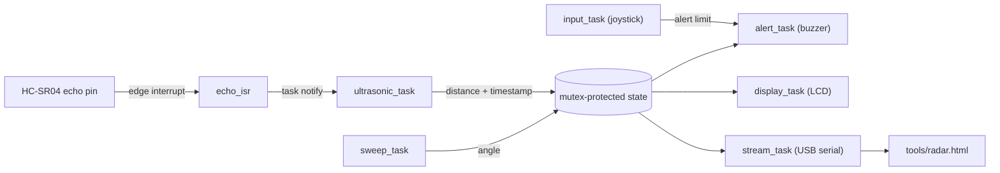

# Sentinel: Real-Time Ultrasonic Radar (ESP32 / FreeRTOS)

A single-ESP32 obstacle radar. A stepper motor sweeps an HC-SR04 ultrasonic sensor across a 90° arc, the echo is timed by a hardware interrupt, and the results are shown on an LCD, sounded on a buzzer when something gets too close, and streamed over USB to a live radar display in the browser.

Written in C on ESP-IDF with FreeRTOS. No Arduino libraries: the LCD driver, stepper driver, and ranging code are all written from scratch.

<!-- TODO: add a screen recording or GIF of the radar next to the hardware, e.g. docs/demo.gif -->


## Features

- **Interrupt-timed ranging.** An any-edge GPIO interrupt on the echo pin timestamps the pulse with `esp_timer_get_time()` (microsecond resolution). The ISR does nothing else and wakes a task.
- **Concurrent FreeRTOS tasks** for ranging, sweeping, alerting, display, input, and streaming, with priorities chosen by timing criticality.
- **Mutex-protected shared state** that carries a timestamp, so every consumer can tell fresh data from stale data.
- **Failsafe behaviour.** If the sensor task stops reporting for more than 500 ms, the LCD shows `NO SIGNAL` and the buzzer stays silent.
- **Joystick-adjustable alert limit** (5-100 cm), calibrated at boot.
- **Distance-scaled alert.** The buzzer beeps faster as the object gets closer.
- **Live radar GUI** (`tools/radar.html`) that reads the serial stream directly in Chrome or Edge using the Web Serial API. It has a demo mode that needs no hardware.
- **From-scratch drivers:** half-step control for a 28BYJ-48 stepper, and a 4-bit HD44780 LCD driver over an I2C (PCF8574) backpack, with a bus scan at startup.

## How it works



| Task | Priority | Role |
|---|---|---|
| `ultrasonic_task` | 6 | Sends the trigger pulse, sleeps until the ISR notifies it (30 ms timeout), publishes the distance |
| `sweep_task` | 5 | Half-steps the motor back and forth, publishes the angle |
| `alert_task` | 4 | Beeps when the distance is under the limit; silent if the data is stale |
| `display_task` | 3 | Refreshes the 16x2 LCD at 5 Hz |
| `input_task` | 2 | Reads the joystick and adjusts the alert limit |
| `stream_task` | 2 | Prints one serial line per new measurement |

### Design decisions

- **The ISR only captures.** It reads the clock, computes the pulse width on the falling edge, and signals the task with `vTaskNotifyGiveFromISR`. All real work happens in task context. The ISR is placed in IRAM so flash activity cannot delay it.
- **Priorities follow timing needs.** The ranging task is highest because it must react quickly to the echo, but it spends nearly all its time blocked, so it cannot starve the others. Slow I2C display writes sit below the alert task so a screen refresh can never delay a beep.
- **A mutex guards multi-field state; `volatile` covers single-writer words.** The `{angle, distance, timestamp}` struct needs consistency across fields, so tasks copy it under a short lock and work on the copy. The alert limit has one writer and one field, so it needs no lock.
- **Staleness instead of trust.** The distance writer stamps each update, and consumers check the age. A stalled sensor task cannot leave a stale reading on the display or the buzzer.
- **Outputs default to off.** The buzzer is silenced whenever data is missing or implausible.
- **Logging stays out of the time-critical path.** Serial output runs in its own low-priority task because a UART write takes about a millisecond.
- **Self-calibrating joystick.** The module's resting value was not at mid-scale, so the thresholds are derived from a measurement at boot instead of a fixed constant.

## Hardware

| Part | Notes |
|---|---|
| ESP32 DevKit V1 (ESP32-WROOM-32) | One board runs everything |
| HC-SR04 ultrasonic sensor | ECHO output is 5 V, so it goes through a voltage divider |
| 28BYJ-48 stepper + ULN2003 driver board | Sweep actuator |
| 16x2 LCD with PCF8574 I2C backpack | Found at address 0x27 by the bus scan |
| Analog joystick module | One axis used for the alert limit |
| Buzzer | Driven with a 2.5 kHz PWM tone from the LEDC peripheral |
| Resistors (1 kΩ and 2 kΩ), breadboard, jumper wires | Echo-line voltage divider |

### Wiring

| Function | ESP32 pin | Notes |
|---|---|---|
| Stepper IN1-IN4 | GPIO 12, 13, 14, 27 | Driver board powered from VIN (5 V) |
| HC-SR04 TRIG | GPIO 25 | |
| HC-SR04 ECHO | GPIO 26 | Through a divider: 1 kΩ in series, 2 kΩ to GND |
| LCD SDA / SCL | GPIO 32 / 33 | Backpack powered from VIN (5 V) |
| Joystick axis | GPIO 35 | ADC1 channel 7. **Power the joystick from 3V3, never 5 V** |
| Buzzer + | GPIO 23 | Other leg to GND |

All modules share one ground. GPIO 34-39 are input-only on the ESP32, which is why the buzzer is not on one of them.

## Build and flash

Developed with **ESP-IDF v6.1.0** on macOS using the VS Code ESP-IDF extension.

```bash
idf.py set-target esp32
idf.py build
idf.py -p <your-serial-port> flash monitor
```

`sdkconfig.defaults` sets `CONFIG_FREERTOS_HZ=1000`. The stepper timing depends on 1 ms ticks, and a `_Static_assert` fails the build if the setting is wrong.

## Radar GUI

1. Open `tools/radar.html` in **Chrome or Edge** (Safari does not support Web Serial).
2. Click **Demo** to see it with simulated objects.
3. To use real data, close any serial monitor (only one program can hold the port), click **Connect**, and choose the board's `usbserial` port. Opening the port resets the ESP32, which is normal.
4. If the browser will not offer the port picker from a local file, run `python3 -m http.server` in the repo folder and open `http://localhost:8000/tools/radar.html`.

The display shows the sweep with a fading trail, range rings (50, 100, or 200 cm), and every measurement as an arc that fades over a few seconds. Anything inside the alert limit turns red, and the limit is drawn as a dashed arc that moves when you use the joystick.

### Serial protocol

One line per measurement at about 15 Hz:

```
R,<angle_deg>,<distance_cm>,<limit_cm>
```

`distance_cm` of `65535` means no echo. Other log lines on the same port are ignored by the GUI.

## Results

<!-- TODO: fill this table from a ruler test (average of ~20 readings per distance) before publishing -->

| True distance (cm) | Mean reading (cm) | Error (cm) |
|---|---|---|
| 10 | TODO | TODO |
| 20 | TODO | TODO |
| 40 | TODO | TODO |
| 80 | TODO | TODO |

## Limitations and next steps

- **Ultrasonic outliers.** Angled or soft surfaces occasionally return a wrong reading, which can cause a single stray beep. A median filter over the last few samples is the obvious fix.
- **Wide beam.** The HC-SR04 beam is roughly 15° wide, so angular resolution is much coarser than the stepper's.
- **Open-loop sweep.** The stepper has no homing switch, so its angle is relative to the position at power-up.
- **Mirrored angles.** Which way the motor turns on positive steps depends on how the coil wires are connected. If left and right appear swapped on your build, negate the angle in `sweep_task` or in the GUI's serial handler.

## Project history

Sentinel was first built as two ESP32 nodes: a scanner and a separate display and alert unit, linked wirelessly with ESP-NOW. That version ran end to end, with sequence-numbered packets and a link-loss failsafe on the receiver. One of the boards then failed, so the project was consolidated onto a single node, and this repository contains the single-node firmware.

## License

MIT
